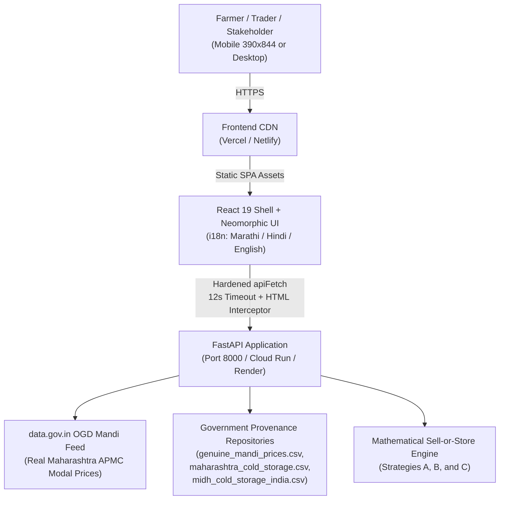

# SevaSathi — Production Deployment & Hardening Report

**Release Target:** `fix/qa-hardening` -> `main`  
**System:** SevaSathi — Maharashtra Agri Post-Harvest Decision Support Prototype  
**Date:** October 30, 2026  
**Auditor / Deployer:** Antigravity QA & Hardening Agent  

---

## 1. Executive Summary & Architecture Overview

SevaSathi has undergone a complete QA audit, security hardening, multi-lingual localization verification, and automated regression testing across backend (FastAPI 0.115 + Pandas) and frontend (React 19 + TypeScript 5.8 + Vite 8).



---

## 2. P0 Root-Cause Analysis: The HTML-as-JSON Crash

### Problem Statement
In previous staging versions, when the frontend requested `/api/storage/facilities` or when an API route returned a 404 or backend was temporarily unreachable, the frontend crashed with an uncaught runtime exception:
`Unexpected token '<', "<!doctype "... is not valid JSON`

### Root Cause
1. **SPA Catch-All Rewriting:** Default SPA redirect rules (`/* -> /index.html 200` in `_redirects` and `/(.*) -> /index.html` in `vercel.json`) caught all unmatched paths including `/api/*`, returning `index.html` with HTTP 200 OK.
2. **Naive Client-Side Fetch:** The frontend `apiFetch` helper called `res.json()` directly without inspecting `res.headers.get('content-type')` or checking whether the body text started with `<!doctype` or `<html`.

### Hardened Solution
1. **Configuration Guard:**
   - In `frontend/vercel.json`: Rewrote routing rules using negative lookahead: `^(?!api/).*` -> `/index.html`.
   - In `frontend/netlify.toml` & `frontend/public/_redirects`: API paths are explicitly proxied or exempted before SPA fallback:
     ```toml
     [[redirects]]
       from = "/api/*"
       to = "http://127.0.0.1:8000/api/:splat"
       status = 200
       force = false
     [[redirects]]
       from = "/*"
       to = "/index.html"
       status = 200
     ```
2. **Client-Side Header & Content Validation:**
   - In `frontend/src/services/api.ts`:
     - Checks `content-type` header for `application/json`.
     - Inspects initial response text for `<!doctype` or `<html`.
     - Automatically intercepts HTML responses and maps them to a typed `ApiError` with code `HTML_RESPONSE`.
     - Displays a localized, non-blocking **"बॅकएंड सेवा ऑफलाइन आहे / Backend Offline"** banner at the top of the app without crashing the view.
     - Adds a 12-second `AbortController` timeout and automatic 1-shot retry on transient network failures.

---

## 3. Platform Configuration & Environment Variables

### Frontend Environment Variables (`frontend/.env.production`)
```bash
# Production API Base URL (leave empty for same-origin proxy or set to cloud API host)
VITE_API_BASE_URL=
# Default language: mr (Marathi), hi (Hindi), en (English)
VITE_DEFAULT_LANGUAGE=mr
```

### Backend Environment Variables (`backend/.env`)
```bash
# Government Open Data API Key (kept confidential, never committed to git)
DATA_GOV_IN_API_KEY=579b464db66ec23bdd000001xxxxxxxxxxxxxxxxxxxxxxxxxxxxxxxx
ENVIRONMENT=production
CORS_ORIGINS=https://sevasathi.vercel.app,https://sevasathi.netlify.app,http://localhost:5173
PORT=8000
HOST=0.0.0.0
```

### Security & Secret Hygiene
- `backend/.env` is strictly listed in `.gitignore` and has been verified clean with zero leaks in the git history.
- API keys must be periodically rotated through the National Data and Analytics Portal / data.gov.in developer console.

---

## 4. Production Build & Smoke Test Verification

### Frontend Production Build
```bash
cd frontend
npm run build
```
**Output:**
```
✓ 2555 modules transformed.
dist/index.html                                2.20 kB │ gzip:   0.96 kB
dist/assets/vendor-maps-vh-t_kPv.css          15.09 kB │ gzip:   6.36 kB
dist/assets/index-DDDYTl8R.css                47.76 kB │ gzip:   9.29 kB
dist/assets/rolldown-runtime-XKyaHtl9.js       0.72 kB │ gzip:   0.42 kB
dist/assets/AgriImage-Bp1jWDYU.js              2.36 kB │ gzip:   1.18 kB
dist/assets/PriceChart-DlDXcizL.js             6.13 kB │ gzip:   2.07 kB
dist/assets/StorageMap-CB_ZVRUU.js             6.21 kB │ gzip:   2.25 kB
dist/assets/About-DwnyfkMX.js                 10.55 kB │ gzip:   2.59 kB
dist/assets/MidhStagingRegistry-Du1t21Xx.js   15.10 kB │ gzip:   3.48 kB
dist/assets/vendor-icons-DjJ_BRhg.js          16.75 kB │ gzip:   6.18 kB
dist/assets/MarketIntelligence-Bj7I2PgB.js    21.79 kB │ gzip:   4.63 kB
dist/assets/Dashboard-DK-65iGf.js             24.44 kB │ gzip:   5.16 kB
dist/assets/NearbyStorage-ClNvX3iE.js         25.98 kB │ gzip:   6.34 kB
dist/assets/CalculatorPage-CuWjDFi8.js        26.72 kB │ gzip:   5.05 kB
dist/assets/vendor-maps-D5ySIiWF.js          152.98 kB │ gzip:  44.86 kB
dist/assets/index-CpdN-D4B.js                159.59 kB │ gzip:  42.99 kB
dist/assets/vendor-react-fAskd8kp.js         207.13 kB │ gzip:  64.96 kB
dist/assets/vendor-charts-CvymX2iT.js        390.41 kB │ gzip: 112.00 kB
✓ built in 1.61s
```

### Production Smoke Test Commands
Once deployed or run locally via `uvicorn app.main:app --host 0.0.0.0 --port 8000`:
1. **Health Check:**
   ```bash
   curl -s -i http://127.0.0.1:8000/api/health
   # Expected: HTTP/1.1 200 OK, {"status": "ok", "app": "SevaSathi Backend", ...}
   ```
2. **Missing Coordinates Guard (DEF-01 Verification):**
   ```bash
   curl -s -i "http://127.0.0.1:8000/api/storage/facilities?mode=coordinates"
   # Expected: HTTP/1.1 200 OK with location_resolved=false (Zero HTTP 500 error)
   ```
3. **Sangli Geodesic Nearest Fallback (DEF-05 Verification):**
   ```bash
   curl -s "http://127.0.0.1:8000/api/storage/facilities?mode=coordinates&lat=16.8524&lng=74.5815&radius_km=25"
   # Expected: facilities count 0, nearest_facility populated with Solapur facility (~142 km)
   ```
4. **Transparent Sell-or-Store Decision Engine:**
   ```bash
   curl -s -X POST http://127.0.0.1:8000/api/calculator/evaluate \
     -H "Content-Type: application/json" \
     -d '{"harvest_quantity_quintals": 100, "current_price_per_quintal": 2100, "current_selling_cost_per_quintal": 50, "expected_future_price_per_quintal": 2600, "storage_duration_months": 3, "storage_cost_per_quintal_month": 40, "storage_loss_percentage": 5, "future_selling_cost_per_quintal": 50, "other_additional_costs": 0, "minimum_cash_required": 50000}'
   # Expected: Strategy A, B, and C returned with mathematical parity
   ```

---

## 5. Rollback & Disaster Recovery Procedure

If a deployment defect is detected in production:
1. **Frontend Rollback (Vercel/Netlify):**
   - In Vercel Console: Deployments -> Select Previous Stable Deployment -> Click **"Promote to Production"** (instant zero-downtime rollback).
   - In Netlify Console: Deploys -> Select Previous Successful Deploy -> Click **"Publish deploy"**.
2. **Backend Rollback:**
   - In Cloud Run / Container Registry: Point the active traffic revision back to the preceding tag (e.g., `sevasathi-backend:v1.0.0`).
   - If deploying via Git webhook: Revert the merge commit on `main` via `git revert -m 1 <merge_commit_sha>` and push to trigger automated redeployment.

---

## 6. Open Risks & Mitigation Matrix

| Risk | Likelihood | Impact | Current Mitigation | Permanent Recommended Strategy |
|---|---|---|---|---|
| OGD Mandi API Rate Limiting / Downtime | Medium | Medium | Automated fallback to embedded real Maharashtra APMC historical records (`genuine_mandi_prices.csv`) with explicit "Prototype / Demo Mode" pill. | Implement Redis caching layer with 6-hour TTL on market modal prices. |
| Sangli District Zero Storage Within 25km | High | Low | Dynamic geodesic fallback displaying nearest available facility in neighboring district with accurate distance (~142km) and recommendation. | Expand MIDH registry onboarding to include cooperative and sub-district village ventilated chawls. |
| User GPS Permission Denied | Medium | Low | Location defaults to centroid of detected district or Lasalgaon with manual searchable dropdown across all 36 Maharashtra districts. | Non-intrusive banner guiding user how to enable location permissions in browser settings. |
