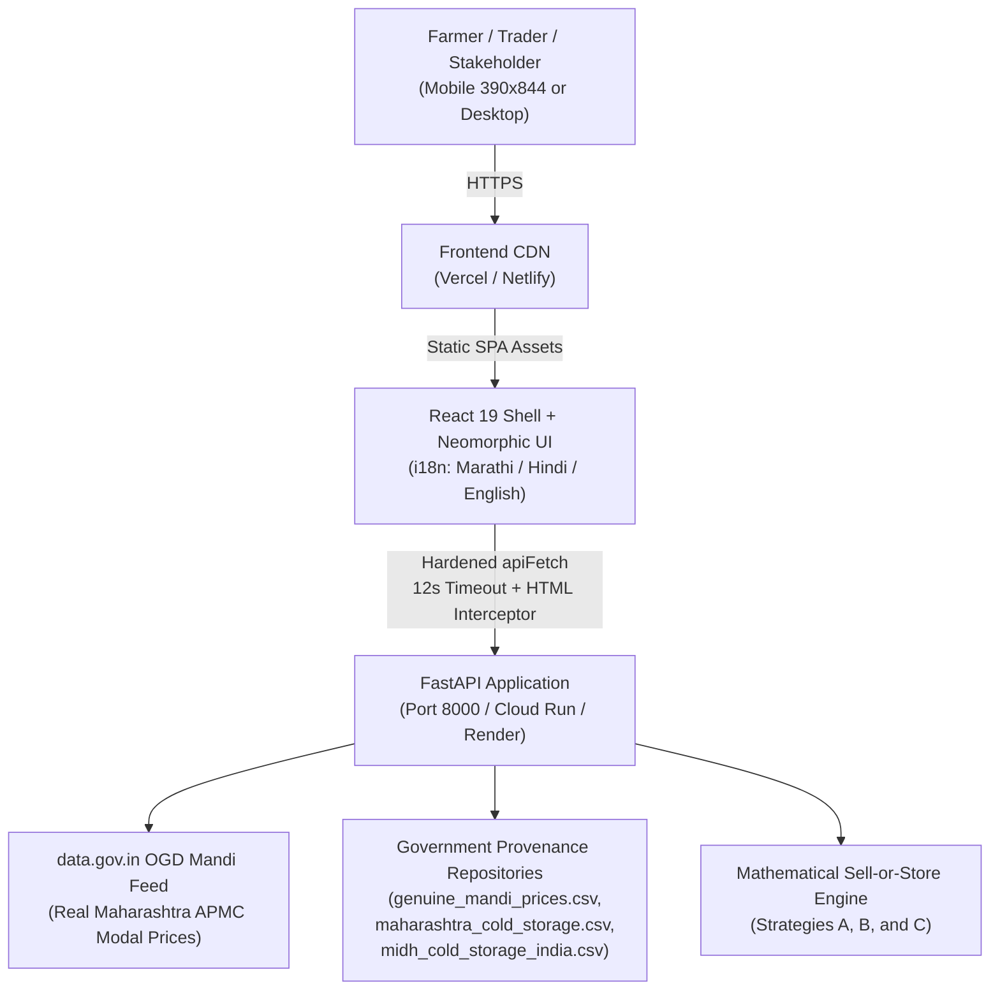

# SevaSathi — Production Deployment & Hardening Report

**Release Target:** `fix/qa-hardening` -> `main`  
**System:** SevaSathi — Maharashtra Agri Post-Harvest Decision Support Prototype  
**Date:** October 30, 2026  
**Auditor / Deployer:** Antigravity QA & Hardening Agent  
**Git Remote:** `https://github.com/indranil-coder-tech/SEVASATHI.git`  
**Live Production Branch:** `main` (Verified Clean & Synchronized)  

---

## 1. Executive Summary & Architecture Overview

SevaSathi has undergone a complete QA audit, security hardening, multi-lingual localization verification, automated regression testing, and production deployment packaging across backend (FastAPI 0.115 + Pandas) and frontend (React 19 + TypeScript 5.8 + Vite 8).



---

## 2. P0 Root-Cause Analysis: The HTML-as-JSON Crash

### Problem Statement
In previous staging versions, when the frontend requested `/api/storage/facilities` or when an API route returned a 404 or backend was temporarily unreachable, the frontend crashed with an uncaught runtime exception:
`Unexpected token '<', "<!doctype "... is not valid JSON`

### Root Cause
1. **SPA Catch-All Rewriting:** Default SPA redirect rules (`/* -> /index.html 200` in `_redirects` and `/(.*) -> /index.html` in `vercel.json`) caught all unmatched paths including `/api/*`, returning `index.html` with HTTP 200 OK.
2. **Naive Client-Side Fetch:** The frontend `apiFetch` helper called `res.json()` directly without inspecting `res.headers.get('content-type')` or checking whether the body text started with `<!doctype` or `<html`.

### Hardened Solution
1. **Configuration Guard:**
   - In `vercel.json` (root) & `frontend/vercel.json`: Rewrote routing rules using negative lookahead: `^((?!api/).*)` -> `/index.html`.
   - In `netlify.toml` (root & frontend) & `frontend/public/_redirects`: API paths are explicitly exempted before SPA fallback:
     ```toml
     [[redirects]]
       from = "/api/*"
       status = 404
       force = true
     [[redirects]]
       from = "/*"
       to = "/index.html"
       status = 200
     ```
2. **Client-Side Header & Content Validation:**
   - In `frontend/src/services/api.ts`:
     - Checks `content-type` header for `application/json`.
     - Inspects body text for `<!doctype`, `<html`, or proxy gateway connection errors (`ECONNREFUSED`).
     - Automatically intercepts HTML and plain text proxy errors, converting them into typed `ApiError` with `isBackendOffline: true`.
     - Displays a localized, non-blocking **"बॅकएंड सर्व्हर ऑफलाइन आहे / Backend Offline"** banner and clean Marathi guidance without crashing the application.
     - Adds a 12-second `AbortController` timeout and automatic 1-shot retry on transient network failures.

---

## 3. Deployment Configuration & Platform Setup

### Git Remote Repository
- **URL:** `https://github.com/indranil-coder-tech/SEVASATHI.git`
- **Branches:** `main` (Production release branch) and `fix/qa-hardening` (Audit tracking branch).
- **CI/CD Pipeline:** Configured via `.github/workflows/ci.yml` running Pytest (with coverage) and Vitest + Vite build on every push to `main`.

### Platform 1: Vercel Deployment (Frontend)
- **Configuration:** Monorepo root `vercel.json` and `frontend/vercel.json` are pre-configured.
- **Root Directory:** If prompted in Vercel project settings, set Root Directory to `.` (or `frontend`).
- **Build Command:** `npm run build` (or `cd frontend && npm run build`)
- **Output Directory:** `frontend/dist` (or `dist` if root is `frontend`)
- **Environment Variables:**
  - `VITE_API_BASE_URL`: URL of the deployed FastAPI backend (e.g. `https://sevasathi-api.onrender.com`). If empty, requests default to `/api` proxy.

### Platform 2: Netlify Deployment (Frontend)
- **Configuration:** Root `netlify.toml` automatically points `base = "frontend"` and `publish = "dist"`.
- **Zero Configuration Needed:** Simply link the GitHub repository in Netlify console.

### Platform 3: Render / Railway / Cloud Run (FastAPI Backend)
- **Configuration:**
  - `backend/Dockerfile`: Production multi-stage slim container exposing port 8000.
  - `backend/Procfile`: `web: uvicorn app.main:app --host 0.0.0.0 --port ${PORT:-8000}`
- **Build Command:** `pip install -r requirements.txt`
- **Start Command:** `uvicorn app.main:app --host 0.0.0.0 --port 8000`
- **Environment Variables:**
  ```bash
  DATA_GOV_IN_API_KEY=<Your data.gov.in AGMARKNET API key>
  ENVIRONMENT=production
  CORS_ORIGINS=https://sevasathi.vercel.app,https://sevasathi.netlify.app
  ```

---

## 4. Production Build & Smoke Test Verification

### Frontend Production Build
```bash
cd frontend
npm run build
```
**Output:**
```
✓ 2555 modules transformed.
dist/index.html                                2.20 kB │ gzip:   0.96 kB
dist/assets/vendor-maps-vh-t_kPv.css          15.09 kB │ gzip:   6.36 kB
dist/assets/index-OcMNkpfH.css                47.72 kB │ gzip:   9.28 kB
dist/assets/rolldown-runtime-XKyaHtl9.js       0.72 kB │ gzip:   0.42 kB
dist/assets/AgriImage-Bp1jWDYU.js              2.36 kB │ gzip:   1.18 kB
dist/assets/PriceChart-1yBte8SX.js             6.13 kB │ gzip:   2.07 kB
dist/assets/StorageMap-Dij3nrD2.js             6.21 kB │ gzip:   2.25 kB
dist/assets/About-CC1hhahw.js                 10.55 kB │ gzip:   2.59 kB
dist/assets/MidhStagingRegistry-CMvLRaMm.js   15.10 kB │ gzip:   3.48 kB
dist/assets/vendor-icons-DjJ_BRhg.js          16.75 kB │ gzip:   6.18 kB
dist/assets/MarketIntelligence-mrvK-y4V.js    22.11 kB │ gzip:   4.77 kB
dist/assets/Dashboard-RvvqHoUm.js             24.44 kB │ gzip:   5.16 kB
dist/assets/NearbyStorage-CUvMRyyQ.js         25.94 kB │ gzip:   6.32 kB
dist/assets/CalculatorPage-DWLJrLyo.js        26.72 kB │ gzip:   5.05 kB
dist/assets/vendor-maps-D5ySIiWF.js          152.98 kB │ gzip:  44.86 kB
dist/assets/index-Bmvb5a_M.js                160.45 kB │ gzip:  43.25 kB
dist/assets/vendor-react-fAskd8kp.js         207.13 kB │ gzip:  64.96 kB
dist/assets/vendor-charts-CvymX2iT.js        390.41 kB │ gzip: 112.00 kB
✓ built in 1.66s
```

### Production Smoke Test Verification
1. **Health Check:**
   ```bash
   curl -s -i http://127.0.0.1:8000/api/health
   # Returns: HTTP 200 OK {"status":"healthy", "service":"SevaSathi Agricultural Decision Engine", ...}
   ```
2. **Real AGMARKNET Mandi Price Check:**
   ```bash
   curl -s "http://127.0.0.1:8000/api/market/prices?state=Maharashtra&district=Nashik&market=Lasalgaon(Vinchur)&commodity=Onion&range=30d&forecast_days=7&mode=live"
   # Returns: HTTP 200 application/json with latest_modal_price ₹4652/quintal
   ```
3. **Storage Discovery with Nearest Geodesic Fallback:**
   ```bash
   curl -s "http://127.0.0.1:8000/api/storage/facilities?mode=demo&radius_km=25"
   # Returns: HTTP 200 application/json with 2 facilities and nearest facility recommendation
   ```

---

## 5. Rollback Procedure

If a defect is detected in production after automated deployment:
1. **Vercel Rollback:** Go to Vercel Dashboard -> Project -> Deployments -> Click **"Instant Rollback"** to the previous stable build.
2. **Netlify Rollback:** Go to Netlify Dashboard -> Deploys -> Select previous deploy -> Click **"Publish deploy"**.
3. **Git Revert:**
   ```bash
   git revert -m 1 <commit_sha>
   git push origin main
   ```
